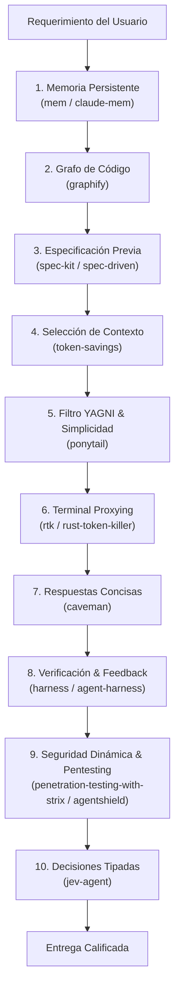

# Suite Core de Invocación Obligatoria para Agentes IA

> Documentación de arquitectura, aplicabilidad y reglas de ejecución para los **7 Pilares Fundamentales** de desarrollo agéntico en `superduperskills`.

---

## 1. Visión General

La **Suite Core** establece una metodología estandarizada para garantizar que cualquier agente de IA (Claude Code, Gemini CLI, Antigravity, OpenCode, Codex, Cursor, etc.) opere con la máxima eficiencia técnica, disciplina arquitectónica y ahorro de tokens.

Antes de construir o modificar cualquier módulo en un proyecto, el agente debe **consultar e invocar primero esta suite**.

---

## 2. Los 7 Pilares de Ejecución



### Pillar 1: `mem` / `claude-mem` (Memoria Persistente)
- **Propósito**: Recuperar y almacenar contexto arquitectónico, patrones preexistentes y decisiones previas entre sesiones.

### Pillar 2: `graphify` (Grafo de Conocimiento del Codebase)
- **Propósito**: Indexar símbolos, imports y llamadas de funciones para responder consultas de dependencias sin necesidad de releer 40+ archivos.

### Pillar 3: `spec-kit` / `spec-driven` (Especificación Técnica)
- **Propósito**: Aplicar [GitHub Spec Kit](https://github.com/github/spec-kit) para escribir requisitos, contratos de API, PRD y desglose de tareas antes de escribir código.
- **Comandos Slash**:
  - `/speckit.init`: Estructurar entorno SDD.
  - `/speckit.constitution`: Reglas no negociables del proyecto.
  - `/speckit.spec`: Documento de requisitos técnicos.
  - `/speckit.tasks`: Desglose secuencial de trabajo.

### Pillar 4: `token-savings` (Optimización de Carga)
- **Propósito**: Confirmar explícitamente cuáles skills aplican a la sesión para evitar cargar metadata pesada e irrelevante en el prompt.

### Pillar 5: `ponytail` (Disciplina Anti-Over-Engineering / YAGNI)
- **Propósito**: Forzar la solución más simple que funcione mediante la "Escala de Pereza Senior":
  1. ¿Necesita existir? (YAGNI).
  2. ¿Ya existe en el codebase? (Reutilizar).
  3. ¿Lo resuelve la stdlib? (Usar stdlib).
  4. ¿Lo resuelve el lenguaje / plataforma nativa? (Usar nativo).
  5. ¿Lo resuelve una librería ya instalada? (Usar dependencia existente).
  6. ¿Puede ser una línea? (Hacerlo en una línea).
  7. Código mínimo.

### Pillar 6: `rtk` (Rust Token Killer & Terminal Proxying)
- **Propósito**: Filtrar la salida de terminal (`git diff`, `npm test`, `pytest`, `cargo check`), reduciendo tokens de logs entre un 60% y 90% mediante deduplicación de stack traces y eliminación de ANSI codes.

### Pillar 7: `caveman` (Compresión de Comunicación)
- **Propósito**: Eliminar muletillas, introducciones vacías y explicaciones no solicitadas en las respuestas del agente, reduciendo el consumo de tokens de salida un 75% sin perder exactitud técnica.

### Pillar 8: `harness` / `agent-harness` (Verificación Automatizada)
- **Propósito**: Definir pruebas automatizadas y arneses de validación para confirmar que los cambios cumplen la especificación antes de finalizar la tarea.

### Pillar 9: `penetration-testing-with-strix` & `agentshield` (Seguridad Dinámica & Pentesting Autónomo)
- **Propósito**: Ejecutar análisis de vulnerabilidades activo, validación dinámica de exploits mediante PoC (Proof-of-Concept) y protección contra inyecciones/fuga de datos en agentes y APIs (`usestrix/strix`).
- **Capacidades**:
  - Simulación red-team autónoma con agentes de explotación dinámica.
  - Generación de scripts PoC para reproducir y verificar fallos de seguridad sin falsos positivos.
  - Parches asistidos con tests de regresión de seguridad (`fix-security-vulnerabilities-with-strix`).
  - Escaneo continuo en CI/CD (`ci-security-scanning-with-strix`).
  - Blindaje de backend con `springboot-security` (Spring Security 6, CSRF, JWT, RBAC) y `owasp-security`.

### Pillar 10: `jev-agent` (Decisiones Tipadas: enrutar, puntuar, verificar)
- **Fuente**: [jev-ai/jev-agent-skill](https://github.com/jev-ai/jev-agent-skill) · instalación upstream: `npx skills add jev-ai/jev-agent-skill`.
- **Propósito**: Obtener una decisión tipada (elección, puntuación o sí/no con probabilidades) desde la API de Jev AI para enrutar tickets, clasificar, verificar evidencia, comprimir contexto o poner una compuerta de seguridad antes de ejecutar una herramienta.
- **Límites**: no sustituye reglas deterministas, búsquedas exactas, escritura abierta ni la aplicación de permisos. La lógica de negocio, los permisos y la aprobación humana siguen siendo de la aplicación.
- **Configuración**: requiere `JEV_API_KEY` (clave `sk_…` de una cuenta Jev AI) en el entorno, y opcionalmente `JEV_LANGUAGE` (`en-US` por defecto, `zh-CN`). Nunca la subas a Git ni la pegues en la conversación. Sin clave, el skill solo guía la configuración.
- **Privacidad**: cada decisión envía el contenido de la consulta a `https://thejevai.com/v1/systemone`. No incluyas secretos ni datos personales en las consultas.
- **Estado en este repo**: solo documentado. Aún no está en `skills/` ni en el manifiesto core del CLI.

#### Repos relacionados (revisados el 2026-10-14, no incluidos en `skills/`)

Todos con licencia MIT. Revisión estática de código y README: sin patrones peligrosos (`curl | sh`, ofuscación, instrucciones ocultas). No se ejecutó ninguno.

| Repo | Qué es | Cuidado |
|------|--------|---------|
| [jkudish/jev-mcp](https://github.com/jkudish/jev-mcp) | Servidor MCP (TypeScript) que expone Jev como herramientas, más 2 `SKILL.md` | Necesita clave de API; el contenido de las consultas sale de tu equipo |
| [tamaratran/fast-jev-compaction](https://github.com/tamaratran/fast-jev-compaction) | Plugin de Claude Code: reemplaza el resumen de compactación puntuando cada llamada y resultado de herramienta con Jev | Envía **cada llamada y resultado de herramienta** (código y salidas) a `api.typesafe.ai` |
| [browser-use/jev-ultrafast](https://github.com/browser-use/jev-ultrafast) | Agente de navegador en Python (Browser Use × TypeSafe) con espacio de acciones indexado | Llama a `api.typesafe.ai` y `api.deepseek.com`; controla un navegador |
| [qkal/Canny](https://github.com/qkal/Canny) | Capa de supervisión: engancha hooks de Claude Code y Codex CLI, lleva un registro de lo que el agente hizo y le impide terminar con solo una afirmación | No es un skill ni está en npm; se instala pidiéndole al agente que clone y ejecute un comando; requiere Node ≥ 22 y modifica los hooks del agente |

#### Skills de diseño y animación

| Repo | Contenido | Estado |
|------|-----------|--------|
| [greensock/gsap-skills](https://github.com/greensock/gsap-skills) | 8 skills oficiales de GSAP: `gsap-core`, `-timeline`, `-scrolltrigger`, `-plugins`, `-react`, `-frameworks`, `-performance`, `-utils` (MIT) | Incorporado en `skills/` |
| [AThevon/genjutsu](https://github.com/AThevon/genjutsu) | `bunshin`, `cast`, `paint` y el paquete compartido `_jutsu` (movimiento de interfaz, identidad de producto, sitio web completo) (MIT) | Incorporado en `skills/` |
| [lottiefiles/motion-design-skill](https://github.com/lottiefiles/motion-design-skill) | `motion-design`: principios de movimiento y dotLottie (MIT) | Incorporado en `skills/` |
| [zanwei/design-dna](https://github.com/zanwei/design-dna) | Extrae y aplica la identidad visual como tokens, estilo y efectos (MIT) | Incorporado como `design-dna-tokens`: el repo ya tenía otro skill `design-dna` distinto (extracción de marca) |
| [CloudAI-X/threejs-skills](https://github.com/CloudAI-X/threejs-skills) | 10 skills de Three.js | **No incorporado**: el repo no tiene licencia, solo se enlaza |

Las licencias MIT de los cuatro repos incorporados están en [`docs/third-party-licenses/`](third-party-licenses/).

------|-----------|----------|
| [CloudAI-X/threejs-skills](https://github.com/CloudAI-X/threejs-skills) | 10 `SKILL.md` de Three.js (3D e interactividad) | **Sin licencia**: no se puede redistribuir; solo enlazar |
| [greensock/gsap-skills](https://github.com/greensock/gsap-skills) | 8 `SKILL.md` oficiales de GSAP (el repo ya trae un `gsap` vía hyperframes) | MIT |
| [zanwei/design-dna](https://github.com/zanwei/design-dna) | 1 `SKILL.md`: extrae y aplica la identidad visual como tokens, estilo y reglas legibles por máquina | MIT |
| [lottiefiles/motion-design-skill](https://github.com/lottiefiles/motion-design-skill) | 1 `SKILL.md` de diseño de movimiento y dotLottie | MIT |
| [AThevon/genjutsu](https://github.com/AThevon/genjutsu) | 20 `SKILL.md` para Claude Code: movimiento de interfaz, identidad de producto y sitio web completo (3.7 MB) | MIT |

---

## 3. Matriz de Combinación y Sinergia

| Combinación | Resultado en el Agente | Impacto en Producción |
|-------------|-------------------------|-----------------------|
| `spec-kit` + `ponytail` | Evita construir características no solicitadas y define contratos mínimos. | Cero código muerto, arquitectura limpia. |
| `rtk` + `caveman` | Comprime tanto la entrada de la terminal como la salida explicativa. | Reducción global del >80% en costos de tokens. |
| `mem` + `harness` | Recuerda errores pasados y los valida automáticamente. | Cero regresiones funcionales entre sesiones. |
| `harness` + `penetration-testing-with-strix` | Combina verificación funcional con pentesting autónomo y validación PoC. | Cero vulnerabilidades explotables en producción. |
| `springboot-security` + `agentshield` | Blindaje de backend robusto con guardrails agénticos anti-inyección. | Seguridad en capas (Defense-in-Depth). |

---

## 4. Guía de Invocación Directa

Los agentes deben invocar estos skills usando las directivas estándar del entorno:

```markdown
- Para planificar un feature: /speckit.spec [feature]
- Para simplificar un diseño: /ponytail full
- Para comprimir explicaciones: /caveman full
- Para ejecutar tests comprimidos: rtk npm test
- Para pentest dinámico con Strix: /penetration-testing-with-strix [target]
- Para auditar CI/CD con Strix: /ci-security-scanning-with-strix
- Para blindar endpoints Spring Boot: /springboot-security [module]
- Para una decisión tipada (rutas, scoring, compuertas): "Use the Jev Agent skill to ..."
```
